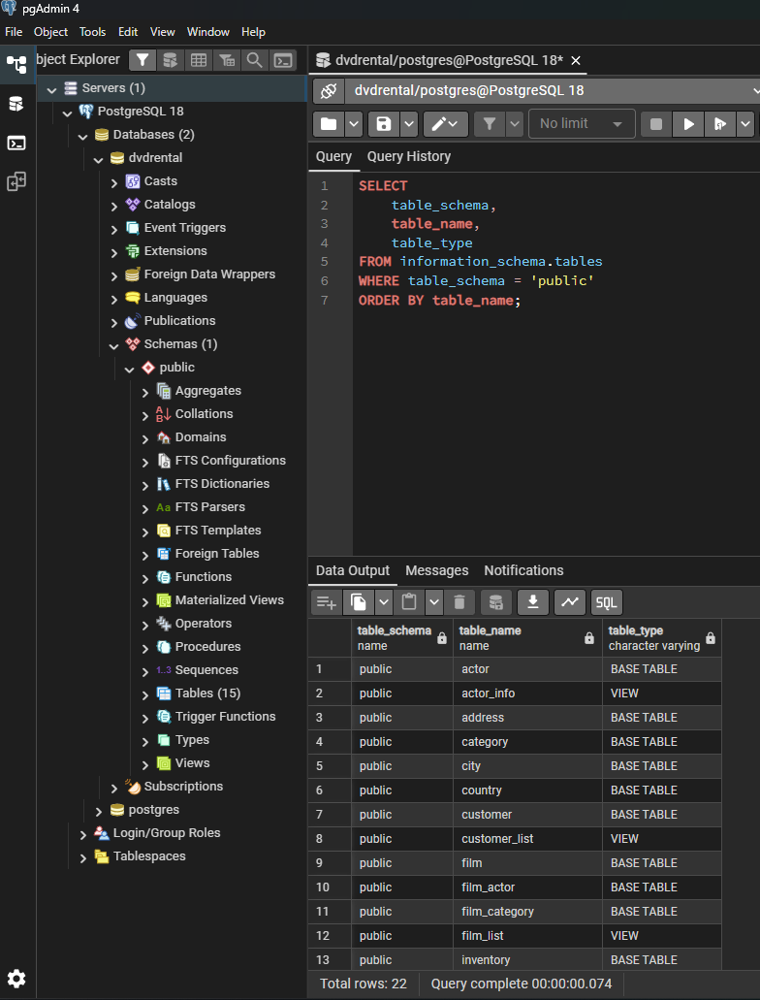
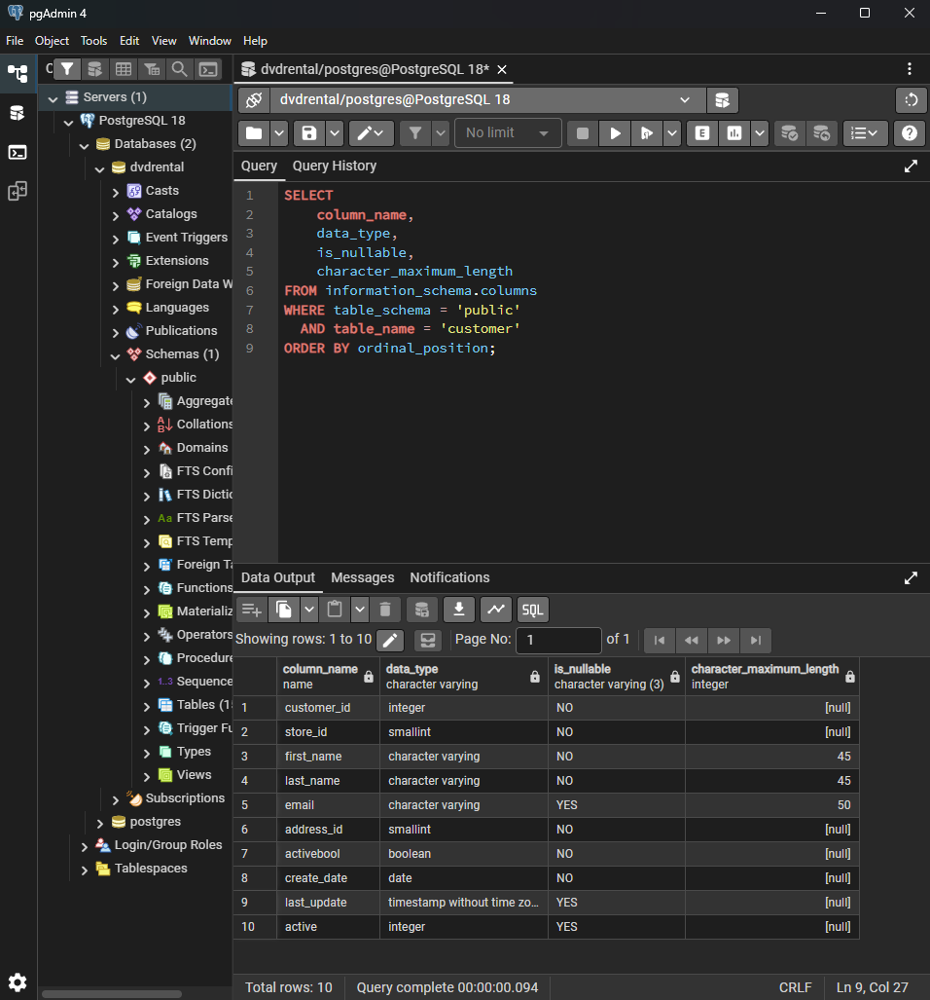
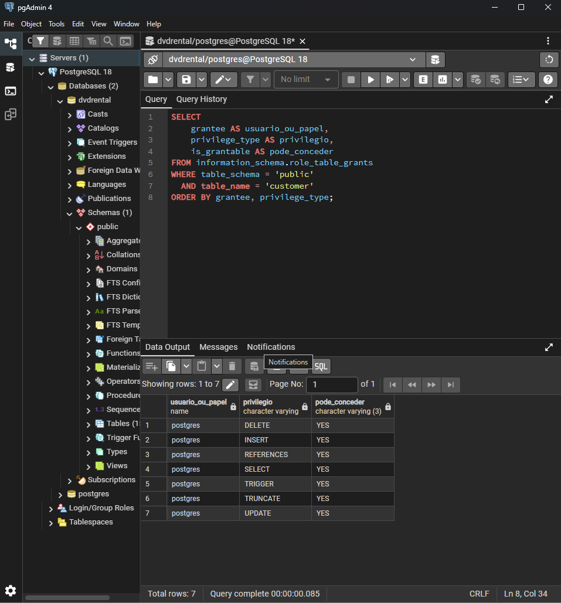

# PostgreSQL Security & Database Auditing

**Laboratório prático de Segurança da Informação aplicada a bancos de dados PostgreSQL**

> **Status:** em desenvolvimento  
> **Ambiente observado:** PostgreSQL 18.6 no Windows · pgAdmin 4  
> **Base de estudo:** `dvdrental` · **Schema:** `public`

## Sobre o projeto

Este projeto documenta a construção gradual de um laboratório de segurança para bancos de dados PostgreSQL. O foco é praticar inventário, revisão de papéis e privilégios, auditoria de atividades e monitoramento de acessos, registrando consultas reproduzíveis e evidências reais das execuções.

A arquitetura planejada evolui de PostgreSQL para **pgAudit + Elasticsearch + Kibana**, com coleta de eventos, pesquisa e dashboards. A integração dessas ferramentas ainda não foi implementada nem validada.

## Objetivos

- Diagnosticar o ambiente e inventariar objetos do banco.
- Examinar a estrutura de tabelas e a exposição de dados.
- Revisar papéis, associações e privilégios efetivos.
- Avaliar e configurar o pgAudit com escopo definido.
- Encaminhar logs ao Elasticsearch e investigar eventos.
- Criar visualizações e dashboards no Kibana.
- Documentar decisões, limitações e evidências verificáveis.

## Tecnologias e estado

| Tecnologia | Papel no projeto | Estado |
|---|---|---|
| PostgreSQL 18.6 | Banco de dados do laboratório | Ambiente observado |
| SQL | Consultas de diagnóstico e revisão | Em uso |
| pgAdmin 4 | Administração e execução das consultas | Em uso |
| pgAudit | Auditoria de atividades | Pendente de avaliação/configuração |
| Elasticsearch | Ingestão e pesquisa de logs | Pendente |
| Kibana | Visualizações e dashboards | Pendente |
| Git/GitHub | Versionamento e documentação | Em uso |

## Evidências práticas

As imagens abaixo são capturas reais do pgAdmin fornecidas para documentar o laboratório. Cada seção apresenta o objetivo, a consulta executada e o que é possível concluir do resultado.

### 1. Diagnóstico do ambiente

A consulta utiliza `version()`, `current_database()` e `current_user` para registrar a versão do PostgreSQL, o banco conectado e o usuário efetivo da sessão.


**Resultado observado:** PostgreSQL 18.6 em Windows 64 bits; banco `dvdrental`; usuário `postgres`.

### 2. Inventário de objetos do schema `public`

A consulta lê `information_schema.tables` e filtra `table_schema = 'public'`, listando nomes e tipos de objetos expostos nessa visão de metadados.



**Resultado observado:** a consulta retornou 22 linhas. A lista inclui tabelas-base e views, conforme a classificação apresentada no resultado. A contagem corresponde ao filtro e à consulta mostrados, não necessariamente a todos os tipos de objetos existentes no schema.

### 3. Estrutura da tabela `public.customer`

A consulta lê `information_schema.columns` para mostrar o nome de cada coluna, o tipo de dado, a nulabilidade e o limite máximo de caracteres, ordenando pela posição da coluna.



**Resultado observado:** 10 colunas. A saída permite identificar, por exemplo, quais campos aceitam `NULL` e quais têm limites de caracteres definidos. Esta inspeção de metadados não demonstra, por si só, que houve minimização dos dados ou que os dados estejam protegidos.

### 4. Privilégios associados à tabela `public.customer`

A consulta usa `information_schema.role_table_grants` para listar o beneficiário, o tipo de privilégio e se ele pode conceder esse privilégio a outros usuários.



**Resultado observado:** a consulta retornou sete linhas para `postgres`: `DELETE`, `INSERT`, `REFERENCES`, `SELECT`, `TRIGGER`, `TRUNCATE` e `UPDATE`, com `YES` na coluna `is_grantable`.

**Limitação importante:** `role_table_grants` não deve ser tratado como uma visão completa de todos os caminhos possíveis de autorização. O resultado mostra os grants expostos por essa consulta e não substitui a análise de privilégios efetivos, propriedade, associações de papéis e privilégios herdados.

## Resumo do que foi executado

- [x] Diagnóstico inicial do ambiente.
- [x] Inventário de objetos retornados pela consulta ao schema `public`.
- [x] Inspeção das 10 colunas de `public.customer`.
- [x] Consulta inicial de grants para `public.customer`.
- [ ] Consolidar a revisão de privilégios efetivos e caminhos de autorização.
- [ ] Avaliar compatibilidade e disponibilidade do pgAudit para PostgreSQL 18.6 no Windows.
- [ ] Configurar o pgAudit, se compatível, e validar a geração de eventos.
- [ ] Implementar a ingestão dos logs no Elasticsearch e verificar os documentos ingeridos.
- [ ] Criar pesquisas, visualizações e dashboards no Kibana.
- [ ] Executar testes controlados de investigação e consolidar relatório técnico.

Uma etapa só será considerada concluída após execução e validação prática. Nenhuma configuração do pgAudit, ingestão no Elasticsearch ou dashboard do Kibana está sendo declarada como pronta neste momento.

## Estrutura do repositório

```text
.
├── README.md
├── INSTRUCOES_ATUALIZACAO.md
├── docs/
│   └── revisao_privilegios.md
├── sql/
│   └── 04_revisao_privilegios.sql
├── evidencias/
│   ├── 01-diagnostico-ambiente.png
│   ├── 02-inventario-objetos-public.png
│   ├── 03-estrutura-tabela-customer.png
│   └── 04-privilegios-customer.png
└── relatorios/
```

## Segurança e limitações

- As consultas apresentadas nesta fase são de leitura de metadados.
- Nenhuma permissão foi alterada durante as consultas documentadas aqui.
- As evidências mostram resultados específicos; não equivalem a uma auditoria completa de segurança.
- Não publicar senhas, dados pessoais ou logs sensíveis.
- As imagens publicadas devem ser capturas reais revisadas e aprovadas pelo autor.

## Documentação relacionada

- [`docs/revisao_privilegios.md`](docs/revisao_privilegios.md) — documentação da revisão inicial.
- [`sql/04_revisao_privilegios.sql`](sql/04_revisao_privilegios.sql) — consultas SQL de revisão de privilégios.

## Repositório

[Henrique-Felix/postgresql-security-audit](https://github.com/Henrique-Felix/postgresql-security-audit)

Projeto pessoal para estudo prático e construção de portfólio em Segurança da Informação.
