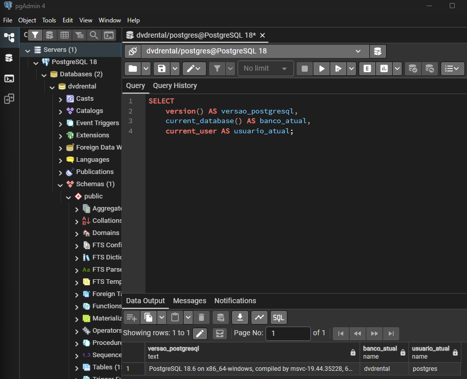

# PostgreSQL Security & Database Auditing

**Status:** Em desenvolvimento  
**Tipo:** Projeto pessoal
**Tecnologias:** PostgreSQL 18.6, SQL, pgAdmin, Git e GitHub

## Sobre o projeto
Projeto pessoal de análise de segurança e auditoria de consultas SQL utilizando a base demonstrativa `dvdrental` no PostgreSQL.

O objetivo é praticar e demonstrar, de forma reproduzível, como inspecionar o ambiente, inventariar objetos, entender a estrutura de tabelas, reduzir a exposição desnecessária de dados em consultas e revisar privilégios de acesso.

> Este é um projeto educacional. Não representa experiência profissional em uma implantação corporativa de Database Activity Monitoring (DAM).

## Evidências já registradas

### 1. Diagnóstico do ambiente
Versão do PostgreSQL, banco conectado e usuário atual da sessão.

### 2. Inventário de objetos do schema `public`
A consulta retornou 22 objetos, incluindo tabelas-base e views.

### 3. Estrutura da tabela `customer`
Inspeção das 10 colunas, tipos de dados, nulabilidade e limites de caracteres.

## Estrutura do repositório
- `docs/`: documentação das análises e conclusões.
- `sql/`: consultas SQL reproduzíveis.
- `evidencias/`: capturas de tela reais das execuções.
- `relatorios/`: espaço para relatórios consolidados.

## Próximas etapas
- Revisar os privilégios de acesso à tabela `public.customer`.
- Documentar os resultados antes de qualquer alteração.
- Explorar boas práticas de minimização de dados em consultas.
- Consolidar os achados em relatório técnico.

## Limitações e segurança
As consultas iniciais são de leitura. Nenhuma permissão foi alterada nesta fase. Resultados e conclusões serão documentados conforme forem observados no laboratório.
